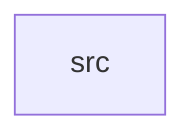

_Generated by CodeAtlas._

## Details

Owns 0 symbols across 1 file(s).

### src

Owns 20 symbols across 1 file(s).

**Related Classes/Methods:** _None_

**Source Files:**

- `compositor/src/lib.rs`
  - `compositor.src.lib.Compositor`
  - `compositor.src.lib.Compositor.commit_surface`
  - `compositor.src.lib.Compositor.compose`
  - `compositor.src.lib.Compositor.default`
  - `compositor.src.lib.Compositor.new`
  - `compositor.src.lib.Compositor.register_output`
  - `compositor.src.lib.Compositor.request_full_redraw`
  - `compositor.src.lib.Compositor.scene`
  - `compositor.src.lib.Compositor.scene_mut`
  - `compositor.src.lib.Compositor.surfaces`
  - `compositor.src.lib.Compositor.surfaces_mut`
  - `compositor.src.lib.Compositor.tick`
  - `compositor.src.lib.Compositor.unregister_output`
  - `compositor.src.lib.FrameReport`
  - `compositor.src.lib.OutputSchedule`
  - `compositor.src.lib.OutputSchedule.new`
  - `compositor.src.lib.tests.committing_damaged_surface_produces_a_frame`
  - `compositor.src.lib.tests.first_tick_forces_full_redraw_even_without_damage`
  - `compositor.src.lib.tests.no_damage_after_first_frame_skips_subsequent_frames`
  - `compositor.src.lib.tests.tick_before_refresh_interval_elapses_produces_nothing`
