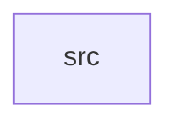

_Generated by CodeAtlas._

## Details

Owns 0 symbols across 1 file(s).

### src

Owns 23 symbols across 1 file(s).

**Related Classes/Methods:** _None_

**Source Files:**

- `configuration/src/lib.rs`
  - `configuration.src.lib.AccessibilitySettings`
  - `configuration.src.lib.AnimationSettings`
  - `configuration.src.lib.AnimationSettings.default`
  - `configuration.src.lib.CursorSettings`
  - `configuration.src.lib.CursorSettings.default`
  - `configuration.src.lib.DisplayConfig`
  - `configuration.src.lib.DisplayConfig.bind_shortcut`
  - `configuration.src.lib.DisplayConfig.from_json`
  - `configuration.src.lib.DisplayConfig.new`
  - `configuration.src.lib.DisplayConfig.output`
  - `configuration.src.lib.DisplayConfig.set_output`
  - `configuration.src.lib.DisplayConfig.to_json`
  - `configuration.src.lib.Orientation`
  - `configuration.src.lib.OutputSettings`
  - `configuration.src.lib.OutputSettings.default`
  - `configuration.src.lib.PowerBehavior`
  - `configuration.src.lib.TouchpadGestures`
  - `configuration.src.lib.WindowBehavior`
  - `configuration.src.lib.WindowBehavior.default`
  - `configuration.src.lib.WorkspaceBehavior`
  - `configuration.src.lib.tests.defaults_are_sensible`
  - `configuration.src.lib.tests.invalid_json_is_rejected`
  - `configuration.src.lib.tests.round_trips_through_json`
