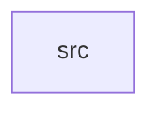

_Generated by CodeAtlas._

## Details

Owns 0 symbols across 1 file(s).

### src

Owns 18 symbols across 1 file(s).

**Related Classes/Methods:** _None_

**Source Files:**

- `cursor/src/lib.rs`
  - `cursor.src.lib.CursorManager`
  - `cursor.src.lib.CursorManager.default`
  - `cursor.src.lib.CursorManager.move_to`
  - `cursor.src.lib.CursorManager.negotiate_render_mode`
  - `cursor.src.lib.CursorManager.new`
  - `cursor.src.lib.CursorManager.set_custom`
  - `cursor.src.lib.CursorManager.set_shape`
  - `cursor.src.lib.CursorManager.set_size`
  - `cursor.src.lib.CursorManager.set_theme`
  - `cursor.src.lib.CursorManager.set_visible`
  - `cursor.src.lib.CursorManager.state`
  - `cursor.src.lib.CursorShape`
  - `cursor.src.lib.CursorState`
  - `cursor.src.lib.CursorState.default`
  - `cursor.src.lib.RenderMode`
  - `cursor.src.lib.tests.accessibility_floor_clamps_small_sizes`
  - `cursor.src.lib.tests.falls_back_to_software_without_hardware_plane`
  - `cursor.src.lib.tests.setting_non_custom_shape_clears_custom_surface`
