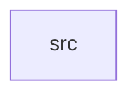

_Generated by CodeAtlas._

## Details

Owns 0 symbols across 1 file(s).

### src

Owns 23 symbols across 1 file(s).

**Related Classes/Methods:** _None_

**Source Files:**

- `diagnostics/src/lib.rs`
  - `diagnostics.src.lib.DebugMode`
  - `diagnostics.src.lib.DebugMode.disable`
  - `diagnostics.src.lib.DebugMode.enable`
  - `diagnostics.src.lib.DebugMode.is_enabled`
  - `diagnostics.src.lib.DebugMode.new`
  - `diagnostics.src.lib.DebugMode.require_enabled`
  - `diagnostics.src.lib.DiagnosticsSnapshot`
  - `diagnostics.src.lib.PerformanceMonitor`
  - `diagnostics.src.lib.PerformanceMonitor.new`
  - `diagnostics.src.lib.PerformanceMonitor.record_frame`
  - `diagnostics.src.lib.PerformanceMonitor.record_input_latency`
  - `diagnostics.src.lib.PerformanceMonitor.record_missed_frame`
  - `diagnostics.src.lib.PerformanceMonitor.set_active_outputs`
  - `diagnostics.src.lib.PerformanceMonitor.set_cpu_utilization`
  - `diagnostics.src.lib.PerformanceMonitor.set_gpu_utilization`
  - `diagnostics.src.lib.PerformanceMonitor.snapshot`
  - `diagnostics.src.lib.average`
  - `diagnostics.src.lib.push_bounded`
  - `diagnostics.src.lib.tests.debug_gate_fails_closed_by_default`
  - `diagnostics.src.lib.tests.debug_gate_opens_once_enabled`
  - `diagnostics.src.lib.tests.dropped_and_missed_frames_are_counted`
  - `diagnostics.src.lib.tests.fps_derives_from_average_frame_time`
  - `diagnostics.src.lib.tests.rolling_window_drops_oldest_sample`
