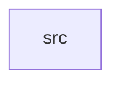

_Generated by CodeAtlas._

## Details

Owns 0 symbols across 1 file(s).

### src

Owns 21 symbols across 1 file(s).

**Related Classes/Methods:** _None_

**Source Files:**

- `input/src/lib.rs`
  - `input.src.lib.GlobalShortcut`
  - `input.src.lib.InputRouter`
  - `input.src.lib.InputRouter.drain`
  - `input.src.lib.InputRouter.keyboard_focus`
  - `input.src.lib.InputRouter.new`
  - `input.src.lib.InputRouter.pointer_over`
  - `input.src.lib.InputRouter.register_global_shortcut`
  - `input.src.lib.InputRouter.request_pointer_capture`
  - `input.src.lib.InputRouter.route`
  - `input.src.lib.InputRouter.service`
  - `input.src.lib.InputRouter.set_keyboard_focus`
  - `input.src.lib.InputRouter.set_keyboard_layout`
  - `input.src.lib.InputRouter.set_pointer_over`
  - `input.src.lib.RoutedEvent`
  - `input.src.lib.tests.focused_surface_receives_its_own_keys_only`
  - `input.src.lib.tests.global_shortcut_intercepts_before_app_focus`
  - `input.src.lib.tests.is_focused_delivery`
  - `input.src.lib.tests.pointer_capture_is_exclusive_and_revocable`
  - `input.src.lib.tests.pointer_motion_routes_to_pointer_over_not_keyboard_focus`
  - `input.src.lib.tests.router_with_controller`
  - `input.src.lib.tests.unfocused_key_events_are_dropped_not_broadcast`
