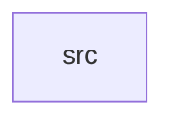

_Generated by CodeAtlas._

## Details

Owns 0 symbols across 1 file(s).

### src

Owns 24 symbols across 1 file(s).

**Related Classes/Methods:** _None_

**Source Files:**

- `outputs/src/lib.rs`
  - `outputs.src.lib.LogicalOutput`
  - `outputs.src.lib.Orientation`
  - `outputs.src.lib.OutputManager`
  - `outputs.src.lib.OutputManager.default`
  - `outputs.src.lib.OutputManager.drop_fallback`
  - `outputs.src.lib.OutputManager.ensure_fallback`
  - `outputs.src.lib.OutputManager.get`
  - `outputs.src.lib.OutputManager.handle_hotplug`
  - `outputs.src.lib.OutputManager.list`
  - `outputs.src.lib.OutputManager.mirror`
  - `outputs.src.lib.OutputManager.new`
  - `outputs.src.lib.OutputManager.observe_connector`
  - `outputs.src.lib.OutputManager.primary`
  - `outputs.src.lib.OutputManager.require_mut`
  - `outputs.src.lib.OutputManager.set_orientation`
  - `outputs.src.lib.OutputManager.set_position`
  - `outputs.src.lib.OutputManager.set_primary`
  - `outputs.src.lib.OutputManager.set_scale`
  - `outputs.src.lib.OutputManager.update_mode`
  - `outputs.src.lib.tests.disconnecting_primary_falls_back_to_next_or_virtual`
  - `outputs.src.lib.tests.hdmi_connector`
  - `outputs.src.lib.tests.observing_real_connector_drops_fallback_and_becomes_primary`
  - `outputs.src.lib.tests.outputs_can_have_independent_scale_and_position`
  - `outputs.src.lib.tests.starts_with_fallback_output_so_session_never_has_zero_outputs`
