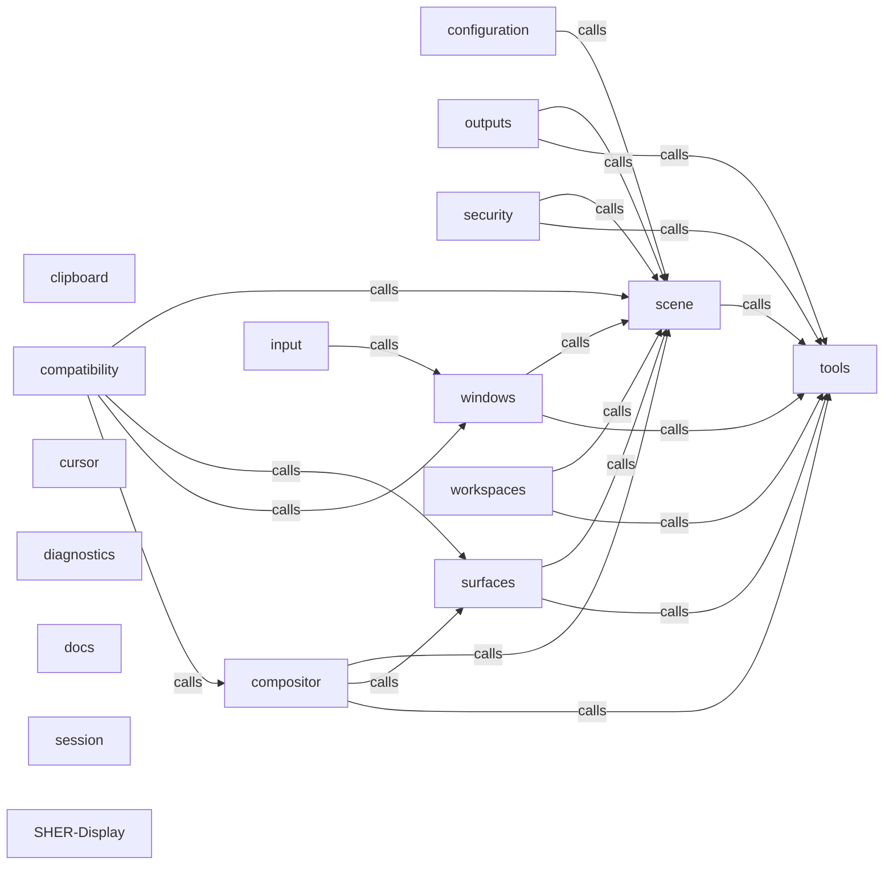

_Generated by CodeAtlas._

## Details

Architecture map of SHER-Display.

### clipboard

Owns 0 symbols across 1 file(s).

**Related Classes/Methods:** _None_

### compatibility

Owns 0 symbols across 0 file(s).

**Related Classes/Methods:** _None_

### compositor

Owns 0 symbols across 1 file(s).

**Related Classes/Methods:** _None_

### configuration

Owns 0 symbols across 1 file(s).

**Related Classes/Methods:** _None_

### cursor

Owns 0 symbols across 1 file(s).

**Related Classes/Methods:** _None_

### diagnostics

Owns 0 symbols across 1 file(s).

**Related Classes/Methods:** _None_

### docs

Owns 0 symbols across 0 file(s).

**Related Classes/Methods:** _None_

### input

Owns 0 symbols across 1 file(s).

**Related Classes/Methods:** _None_

### outputs

Owns 0 symbols across 1 file(s).

**Related Classes/Methods:** _None_

### scene

Owns 0 symbols across 1 file(s).

**Related Classes/Methods:** _None_

### security

Owns 0 symbols across 1 file(s).

**Related Classes/Methods:** _None_

### session

Owns 0 symbols across 1 file(s).

**Related Classes/Methods:** _None_

### surfaces

Owns 0 symbols across 1 file(s).

**Related Classes/Methods:** _None_

### tools

Owns 0 symbols across 0 file(s).

**Related Classes/Methods:** _None_

### windows

Owns 0 symbols across 1 file(s).

**Related Classes/Methods:** _None_

### workspaces

Owns 0 symbols across 1 file(s).

**Related Classes/Methods:** _None_

### SHER-Display

Owns 0 symbols across 12 file(s).

**Related Classes/Methods:** _None_
