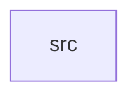

_Generated by CodeAtlas._

## Details

Owns 0 symbols across 1 file(s).

### src

Owns 26 symbols across 1 file(s).

**Related Classes/Methods:** _None_

**Source Files:**

- `scene/src/lib.rs`
  - `scene.src.lib.NodeKind`
  - `scene.src.lib.Point`
  - `scene.src.lib.Rect`
  - `scene.src.lib.Rect.new`
  - `scene.src.lib.Rect.union`
  - `scene.src.lib.SceneGraph`
  - `scene.src.lib.SceneGraph.clear_damage`
  - `scene.src.lib.SceneGraph.get`
  - `scene.src.lib.SceneGraph.get_mut`
  - `scene.src.lib.SceneGraph.has_damage`
  - `scene.src.lib.SceneGraph.insert`
  - `scene.src.lib.SceneGraph.is_empty`
  - `scene.src.lib.SceneGraph.len`
  - `scene.src.lib.SceneGraph.mark_damage`
  - `scene.src.lib.SceneGraph.new`
  - `scene.src.lib.SceneGraph.remove`
  - `scene.src.lib.SceneGraph.z_ordered_for_output`
  - `scene.src.lib.SceneNode`
  - `scene.src.lib.SceneNode.bounds`
  - `scene.src.lib.SceneNode.new`
  - `scene.src.lib.Size`
  - `scene.src.lib.Transform`
  - `scene.src.lib.Transform.identity`
  - `scene.src.lib.tests.damage_accumulates_via_union`
  - `scene.src.lib.tests.hidden_nodes_excluded_from_composition`
  - `scene.src.lib.tests.z_order_sorts_back_to_front`
