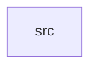

_Generated by CodeAtlas._

## Details

Owns 0 symbols across 1 file(s).

### src

Owns 15 symbols across 1 file(s).

**Related Classes/Methods:** _None_

**Source Files:**

- `security/src/lib.rs`
  - `security.src.lib.Grant`
  - `security.src.lib.Permission`
  - `security.src.lib.PermissionManager`
  - `security.src.lib.PermissionManager.active_grants`
  - `security.src.lib.PermissionManager.check`
  - `security.src.lib.PermissionManager.grant`
  - `security.src.lib.PermissionManager.new`
  - `security.src.lib.PermissionManager.prune_expired`
  - `security.src.lib.PermissionManager.revoke`
  - `security.src.lib.PermissionTier`
  - `security.src.lib.PermissionTier.duration_secs`
  - `security.src.lib.tests.a_grant_for_one_app_does_not_leak_to_another`
  - `security.src.lib.tests.granted_permission_allowed_until_expiry`
  - `security.src.lib.tests.revoke_removes_grant_immediately`
  - `security.src.lib.tests.ungranted_permission_is_denied`
