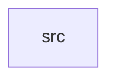

_Generated by CodeAtlas._

## Details

Owns 0 symbols across 1 file(s).

### src

Owns 20 symbols across 1 file(s).

**Related Classes/Methods:** _None_

**Source Files:**

- `session/src/lib.rs`
  - `session.src.lib.GraphicalSession`
  - `session.src.lib.GraphicalSession.add_seat`
  - `session.src.lib.GraphicalSession.default`
  - `session.src.lib.GraphicalSession.lock`
  - `session.src.lib.GraphicalSession.login`
  - `session.src.lib.GraphicalSession.logout`
  - `session.src.lib.GraphicalSession.new`
  - `session.src.lib.GraphicalSession.remove_seat`
  - `session.src.lib.GraphicalSession.restart`
  - `session.src.lib.GraphicalSession.seats`
  - `session.src.lib.GraphicalSession.state`
  - `session.src.lib.GraphicalSession.unlock`
  - `session.src.lib.GraphicalSession.user`
  - `session.src.lib.SessionState`
  - `session.src.lib.tests.cannot_lock_before_logging_in`
  - `session.src.lib.tests.cannot_log_in_twice`
  - `session.src.lib.tests.cannot_unlock_a_session_that_is_not_locked`
  - `session.src.lib.tests.full_lifecycle_happy_path`
  - `session.src.lib.tests.restart_preserves_login_and_returns_to_active`
  - `session.src.lib.tests.seats_survive_logout`
