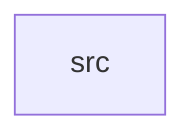

_Generated by CodeAtlas._

## Details

Owns 0 symbols across 1 file(s).

### src

Owns 23 symbols across 1 file(s).

**Related Classes/Methods:** _None_

**Source Files:**

- `surfaces/src/lib.rs`
  - `surfaces.src.lib.SurfaceManager`
  - `surfaces.src.lib.SurfaceManager.ack_frame_callback`
  - `surfaces.src.lib.SurfaceManager.attach_buffer`
  - `surfaces.src.lib.SurfaceManager.commit`
  - `surfaces.src.lib.SurfaceManager.create_surface`
  - `surfaces.src.lib.SurfaceManager.damage`
  - `surfaces.src.lib.SurfaceManager.destroy_surface`
  - `surfaces.src.lib.SurfaceManager.destroy_surfaces_for_client`
  - `surfaces.src.lib.SurfaceManager.get`
  - `surfaces.src.lib.SurfaceManager.is_empty`
  - `surfaces.src.lib.SurfaceManager.len`
  - `surfaces.src.lib.SurfaceManager.new`
  - `surfaces.src.lib.SurfaceManager.require_mut`
  - `surfaces.src.lib.SurfaceManager.resize`
  - `surfaces.src.lib.SurfaceManager.set_opacity`
  - `surfaces.src.lib.SurfaceManager.set_visible`
  - `surfaces.src.lib.SurfaceManager.surfaces_for_client`
  - `surfaces.src.lib.SurfaceRole`
  - `surfaces.src.lib.SurfaceState`
  - `surfaces.src.lib.SurfaceState.new`
  - `surfaces.src.lib.tests.commit_drains_damage_and_arms_frame_callback`
  - `surfaces.src.lib.tests.destroying_client_drops_its_surfaces`
  - `surfaces.src.lib.tests.operating_on_missing_surface_errors`
