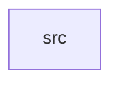

_Generated by CodeAtlas._

## Details

Owns 0 symbols across 1 file(s).

### src

Owns 19 symbols across 1 file(s).

**Related Classes/Methods:** _None_

**Source Files:**

- `compatibility/wayland/src/lib.rs`
  - `compatibility.wayland.src.lib.ClientBookkeeping`
  - `compatibility.wayland.src.lib.WaylandBridge`
  - `compatibility.wayland.src.lib.WaylandBridge.attach_buffer`
  - `compatibility.wayland.src.lib.WaylandBridge.commit`
  - `compatibility.wayland.src.lib.WaylandBridge.connect_client`
  - `compatibility.wayland.src.lib.WaylandBridge.create_surface`
  - `compatibility.wayland.src.lib.WaylandBridge.create_toplevel_window`
  - `compatibility.wayland.src.lib.WaylandBridge.damage`
  - `compatibility.wayland.src.lib.WaylandBridge.default`
  - `compatibility.wayland.src.lib.WaylandBridge.destroy_surface`
  - `compatibility.wayland.src.lib.WaylandBridge.disconnect_client`
  - `compatibility.wayland.src.lib.WaylandBridge.new`
  - `compatibility.wayland.src.lib.WaylandBridge.node_for_surface`
  - `compatibility.wayland.src.lib.WaylandBridge.teardown_surface`
  - `compatibility.wayland.src.lib.WaylandBridge.window_for_surface`
  - `compatibility.wayland.src.lib.tests.creating_surface_for_unknown_client_fails`
  - `compatibility.wayland.src.lib.tests.destroying_one_surface_does_not_touch_a_sibling`
  - `compatibility.wayland.src.lib.tests.disconnecting_client_leaves_no_orphaned_surfaces`
  - `compatibility.wayland.src.lib.tests.full_surface_lifecycle_produces_a_frame`
