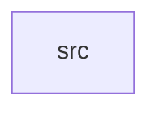

_Generated by CodeAtlas._

## Details

Owns 0 symbols across 1 file(s).

### src

Owns 28 symbols across 1 file(s).

**Related Classes/Methods:** _None_

**Source Files:**

- `windows/src/lib.rs`
  - `windows.src.lib.LayoutMode`
  - `windows.src.lib.SnapEdge`
  - `windows.src.lib.WindowManager`
  - `windows.src.lib.WindowManager.activate`
  - `windows.src.lib.WindowManager.active_window`
  - `windows.src.lib.WindowManager.create_window`
  - `windows.src.lib.WindowManager.destroy_window`
  - `windows.src.lib.WindowManager.get`
  - `windows.src.lib.WindowManager.is_empty`
  - `windows.src.lib.WindowManager.len`
  - `windows.src.lib.WindowManager.minimize`
  - `windows.src.lib.WindowManager.move_to`
  - `windows.src.lib.WindowManager.new`
  - `windows.src.lib.WindowManager.require_mut`
  - `windows.src.lib.WindowManager.resize_to`
  - `windows.src.lib.WindowManager.restore`
  - `windows.src.lib.WindowManager.set_layout`
  - `windows.src.lib.WindowManager.set_modal`
  - `windows.src.lib.WindowManager.snap`
  - `windows.src.lib.WindowManager.windows_for_app`
  - `windows.src.lib.WindowRules`
  - `windows.src.lib.WindowState`
  - `windows.src.lib.WindowState.new`
  - `windows.src.lib.tests.activation_deactivates_previous_window`
  - `windows.src.lib.tests.destroying_active_window_clears_active_slot`
  - `windows.src.lib.tests.fullscreen_window_rejects_move`
  - `windows.src.lib.tests.mgr_with_window`
  - `windows.src.lib.tests.snap_sets_tiled_layout_and_half_width`
