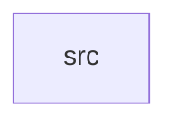

_Generated by CodeAtlas._

## Details

Owns 0 symbols across 1 file(s).

### src

Owns 17 symbols across 1 file(s).

**Related Classes/Methods:** _None_

**Source Files:**

- `workspaces/src/lib.rs`
  - `workspaces.src.lib.Workspace`
  - `workspaces.src.lib.WorkspaceManager`
  - `workspaces.src.lib.WorkspaceManager.active_for_output`
  - `workspaces.src.lib.WorkspaceManager.assign_window`
  - `workspaces.src.lib.WorkspaceManager.create_workspace`
  - `workspaces.src.lib.WorkspaceManager.default`
  - `workspaces.src.lib.WorkspaceManager.delete_workspace`
  - `workspaces.src.lib.WorkspaceManager.get`
  - `workspaces.src.lib.WorkspaceManager.list`
  - `workspaces.src.lib.WorkspaceManager.move_window`
  - `workspaces.src.lib.WorkspaceManager.new`
  - `workspaces.src.lib.WorkspaceManager.switch`
  - `workspaces.src.lib.WorkspaceManager.windows_in`
  - `workspaces.src.lib.tests.cannot_delete_the_last_workspace`
  - `workspaces.src.lib.tests.dynamic_workspaces_grow_when_last_one_fills`
  - `workspaces.src.lib.tests.moving_a_window_updates_both_workspaces`
  - `workspaces.src.lib.tests.outputs_switch_workspaces_independently`
