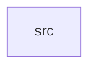

_Generated by CodeAtlas._

## Details

Owns 0 symbols across 1 file(s).

### src

Owns 12 symbols across 1 file(s).

**Related Classes/Methods:** _None_

**Source Files:**

- `compatibility/xwayland/src/lib.rs`
  - `compatibility.xwayland.src.lib.XWaylandBridge`
  - `compatibility.xwayland.src.lib.XWaylandBridge.is_empty`
  - `compatibility.xwayland.src.lib.XWaylandBridge.len`
  - `compatibility.xwayland.src.lib.XWaylandBridge.map_window`
  - `compatibility.xwayland.src.lib.XWaylandBridge.new`
  - `compatibility.xwayland.src.lib.XWaylandBridge.surface_for_window`
  - `compatibility.xwayland.src.lib.XWaylandBridge.unmap_window`
  - `compatibility.xwayland.src.lib.XWaylandBridge.window_for_surface`
  - `compatibility.xwayland.src.lib.tests.cannot_double_map_the_same_xid`
  - `compatibility.xwayland.src.lib.tests.mapping_is_bidirectional`
  - `compatibility.xwayland.src.lib.tests.unmapping_clears_both_directions`
  - `compatibility.xwayland.src.lib.tests.unmapping_unknown_window_errors`
